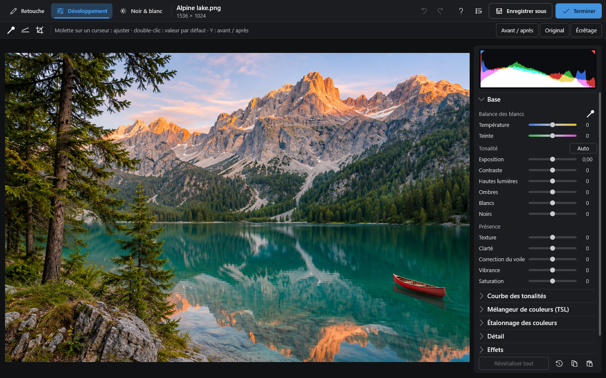
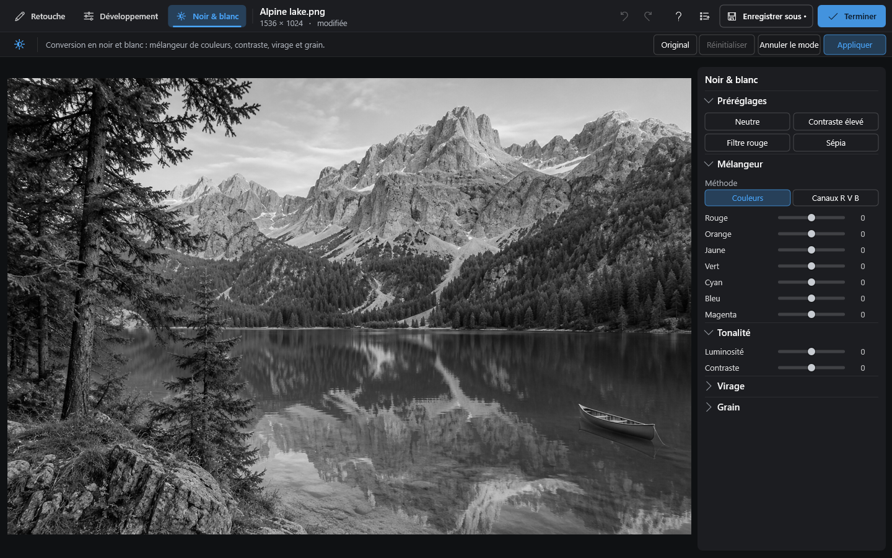
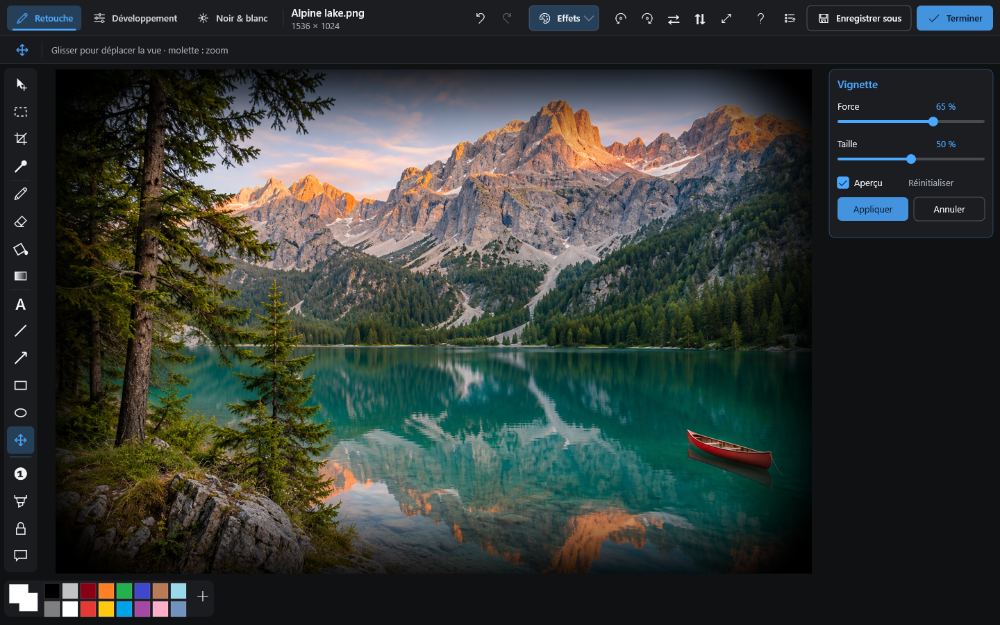

[English](README.md) · **Français** · [Documentation](https://mrmybal.github.io/CyImgView/#/fr/overview)

<p align="center">
  
</p>

<h1 align="center">CyImgView</h1>

Visionneuse d'images pour Windows, pensée pour la vitesse : C++ natif, Direct2D (rendu GPU), WIC,
aucun runtime externe pour l’exécutable principal. La distribution inclut les plugins de formats et un manuel complet hors ligne.


## Modes d’édition et effets

Cliquez sur une capture pour l’ouvrir en grand.

<table>
  <tr>
    <th>Retouche et calques</th>
    <th>Développement photo</th>
  </tr>
  <tr>
    <td width="50%" valign="top">
      <a href="docs/screenshots/editor-fr.png"></a>
      <p>Textes et formes modifiables, avec les commandes des calques.</p>
    </td>
    <td width="50%" valign="top">
      <a href="docs/screenshots/develop-fr.png"></a>
      <p>Histogramme, balance des blancs, tonalité et couleurs.</p>
    </td>
  </tr>
  <tr>
    <th>Noir et blanc</th>
    <th>Galerie d’effets</th>
  </tr>
  <tr>
    <td width="50%" valign="top">
      <a href="docs/screenshots/black-white-fr.png"></a>
      <p>Préréglages, mélangeur de couleurs et contraste.</p>
    </td>
    <td width="50%" valign="top">
      <a href="docs/screenshots/effects-fr.png"></a>
      <p>Comparez les aperçus et choisissez le calque ou l’image entière.</p>
    </td>
  </tr>
  <tr>
    <th>Réglage d’un effet en direct</th>
    <th>Modèles de nouveaux documents</th>
  </tr>
  <tr>
    <td width="50%" valign="top">
      <a href="docs/screenshots/effect-preview-fr.png"></a>
      <p>Ajustez l’effet avec un aperçu, puis appliquez ou annulez.</p>
    </td>
    <td width="50%" valign="top">
      <a href="docs/screenshots/new-document-fr.png"></a>
      <p>Formats écran, photo et impression, avec dimensions personnalisées.</p>
    </td>
  </tr>
</table>

## Installation

Téléchargez l’installeur ou le ZIP portable depuis les [releases GitHub](https://github.com/MrMybal/CyImgView/releases/latest).
L’installation ne nécessite pas de droits administrateur. En version portable, gardez `plugins/` et **tout le dossier `help/`** à côté de l’exécutable.
[Installation, intégration, mises à jour et désinstallation](https://mrmybal.github.io/CyImgView/#/fr/installation).

## Manuel utilisateur

**[Documentation](https://mrmybal.github.io/CyImgView/#/fr/overview)** — Consulter le manuel visuel complet en ligne.

Appuyez sur **F1** ou cliquez sur **?** dans l’application pour ouvrir l’aide du contexte courant.
Le manuel s’ouvre localement depuis `help/index.html`, avec captures, schémas, recherche et comparaisons d’images interactives.
Il fonctionne hors ligne, sans serveur. Les guides sont complets en français et en anglais ; l’aide clavier est conservée dans les 12 langues de l’interface.

- [Bien démarrer](https://mrmybal.github.io/CyImgView/#/fr/quickstart) · [Voir et parcourir les images](https://mrmybal.github.io/CyImgView/#/fr/viewer)
- [Créer un document vierge](https://mrmybal.github.io/CyImgView/#/fr/new-document) · [Peindre et modifier les objets](https://mrmybal.github.io/CyImgView/#/fr/edit)
- [Calques, fusion et masques](https://mrmybal.github.io/CyImgView/#/fr/layers)
- [Galerie d’effets](https://mrmybal.github.io/CyImgView/#/fr/effects) · [Développement](https://mrmybal.github.io/CyImgView/#/fr/develop) · [Noir et blanc](https://mrmybal.github.io/CyImgView/#/fr/black-white)
- [Enregistrer et exporter](https://mrmybal.github.io/CyImgView/#/fr/export) · [Raccourcis](https://mrmybal.github.io/CyImgView/#/fr/keyboard-reference)
- [Paramètres](https://mrmybal.github.io/CyImgView/#/fr/settings) · [Résoudre un problème](https://mrmybal.github.io/CyImgView/#/fr/troubleshooting)

Ces liens ouvrent le lecteur HTML publié, avec navigation, recherche, images et schémas. Le même lecteur est également fourni hors ligne avec l’application.

## Compiler

Visual Studio 2022 avec le développement C++ Desktop, CMake/Ninja et **Node.js 22+** pour générer le manuel :

```powershell
npm --prefix tools/docs ci
./build.ps1
```

L’application et son aide complète sont produites dans `build/Release/bin`.
[Compilation et distribution](https://mrmybal.github.io/CyImgView/#/fr/building) · [Maintenance et vérification du manuel](docs/README.md).

## Références

Les anciens chapitres détaillés du README sont conservés dans le manuel. Leurs adresses de section restent accessibles ici.

<a id="fonctionnalités"></a>
- [Formats et fonctionnalités](https://mrmybal.github.io/CyImgView/#/fr/formats)
<a id="mises-à-jour-github-releases"></a>
- [Mises à jour et releases GitHub](https://mrmybal.github.io/CyImgView/#/fr/updates)
<a id="utilisation"></a>
- [Commandes de la visionneuse](https://mrmybal.github.io/CyImgView/#/fr/keyboard-reference)
<a id="mode-édition"></a>
- [Commandes de l’éditeur](https://mrmybal.github.io/CyImgView/#/fr/keyboard-reference) · [Référence des documents](https://mrmybal.github.io/CyImgView/#/fr/editing-reference)
<a id="paramètres-touche-p-ou-bouton-engrenage"></a>
- [Paramètres](https://mrmybal.github.io/CyImgView/#/fr/settings)
<a id="écrire-un-plugin"></a>
- [API et exemple de plugin de décodage](https://mrmybal.github.io/CyImgView/#/fr/decoder-api)
<a id="écrire-un-plugin-dédition"></a>
- [API et exemples de plugins d’édition](https://mrmybal.github.io/CyImgView/#/fr/editor-api) · [Effets HLSL](https://mrmybal.github.io/CyImgView/#/fr/hlsl)
<a id="mesurer-les-performances"></a>
- [Mesurer les performances](https://mrmybal.github.io/CyImgView/#/fr/performance)
<a id="confidentialité"></a>
- [Confidentialité et fichiers locaux](https://mrmybal.github.io/CyImgView/#/fr/privacy)
<a id="licence"></a>
- [Licences et crédits](https://mrmybal.github.io/CyImgView/#/fr/licenses) · [GNU GPL v3.0](LICENSE)
