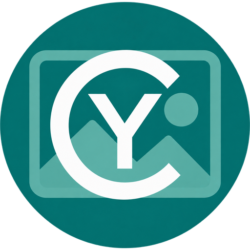
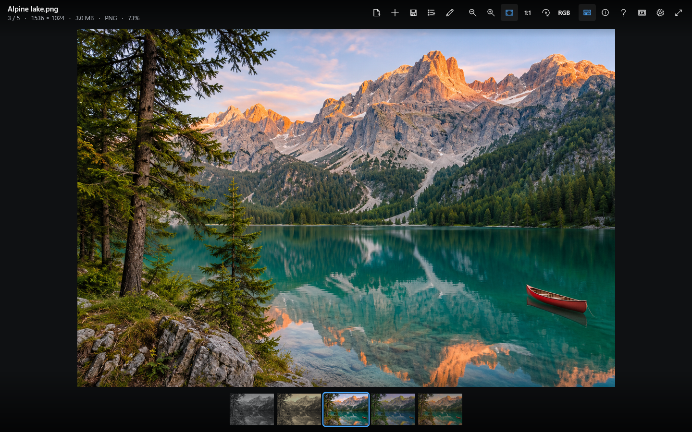
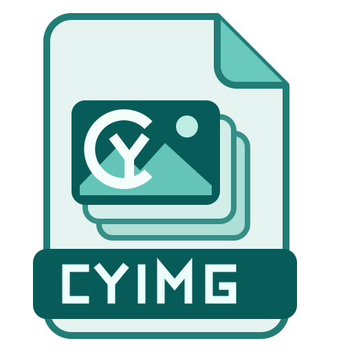
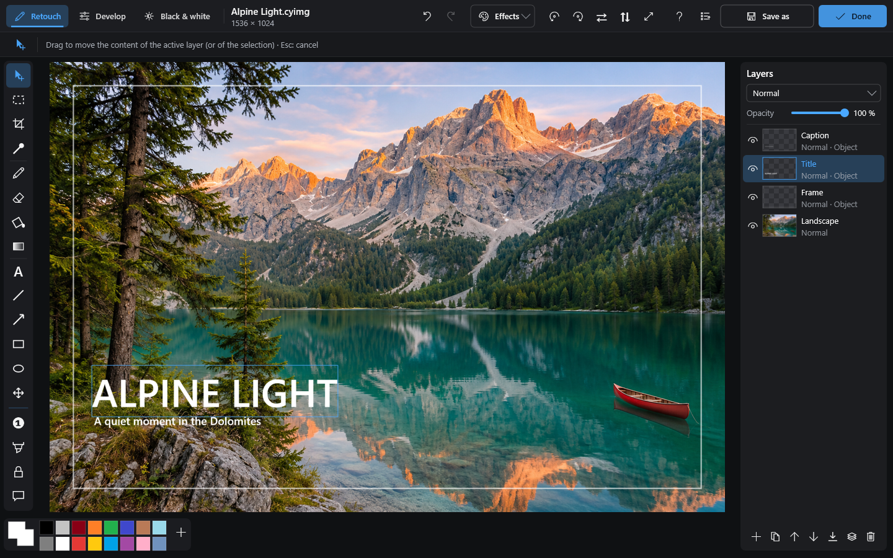
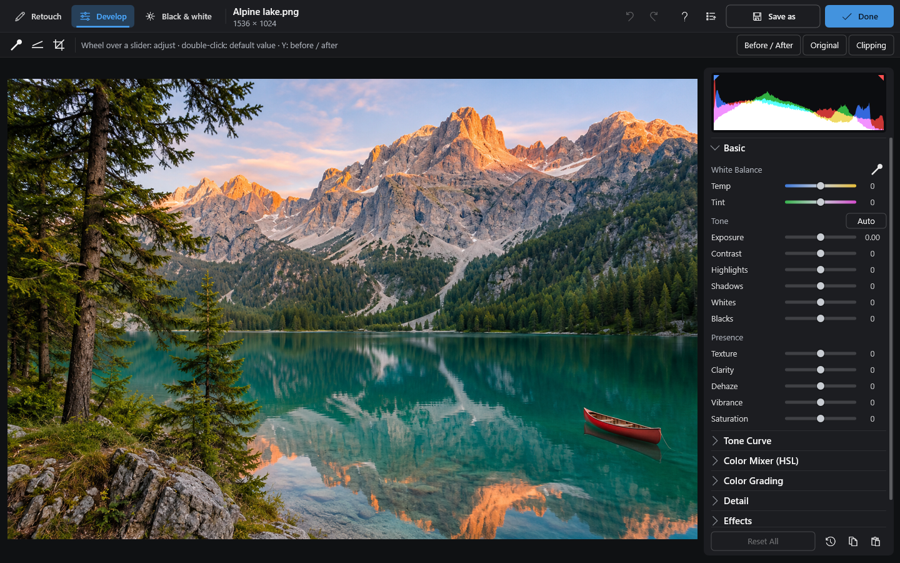
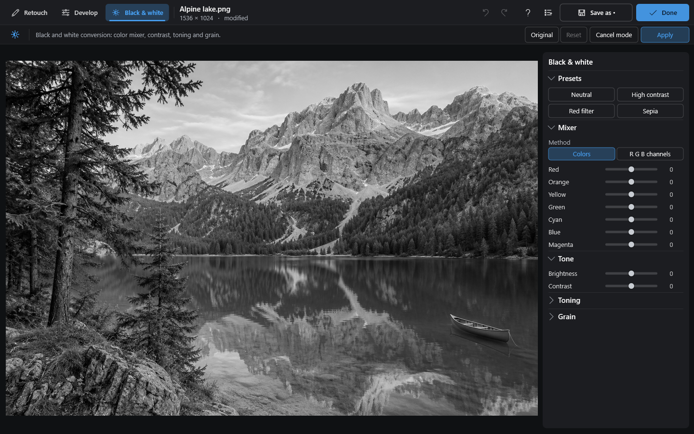
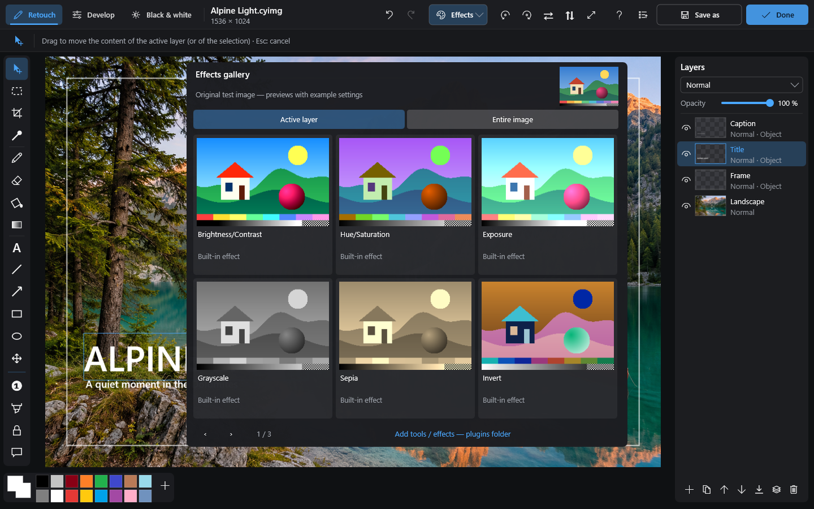
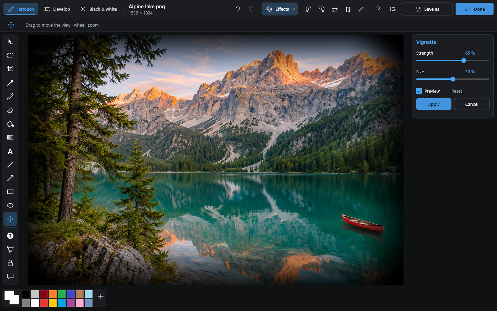
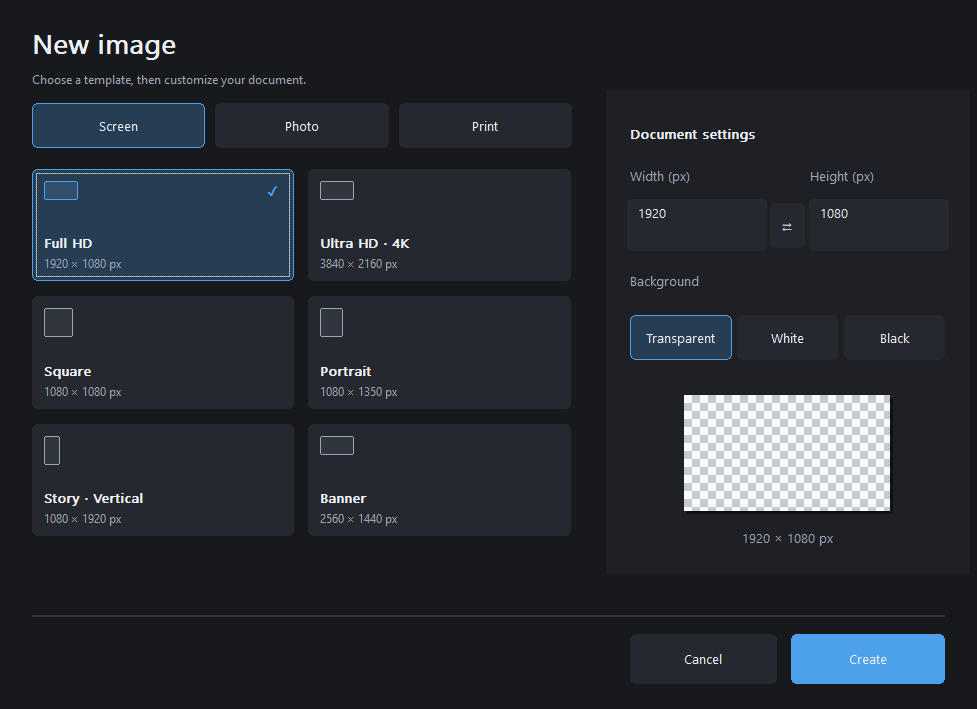

<table width="100%">
  <tr>
    <td width="300" align="left" valign="top">
      <a href="https://mrmybal.github.io/CyImgView/?lang=en">Website</a><br>
      <a href="https://mrmybal.github.io/CyImgView/Documentation.html#/en/overview">Manual</a><br>
      <a href="https://github.com/MrMybal/CyImgView">GitHub</a><br><br>
      <sub>README</sub><br>
      <a href="README.md">English</a> · <a href="README.fr.md">Français</a>
    </td>
    <td width="400" align="center" valign="middle">
      <a href="https://mrmybal.github.io/CyImgView/?lang=en"></a>
    </td>
    <td width="300" align="right" valign="top">
      <p><sub>Application license</sub><br><a href="LICENSE"><strong>GNU GPL v3.0</strong></a></p>
      <p><sub>Version</sub><br><a href="docs/releases/1.10.2.md"><strong>1.10.2</strong></a><br><strong>Active development</strong></p>
      <p><a href="https://github.com/MrMybal/CyImgView/releases/download/v1.10.2/CyImgView-1.10.2-Setup.exe"><strong>Download</strong></a><br><sub>Windows x64 · installer</sub><br><a href="https://github.com/MrMybal/CyImgView/releases/download/v1.10.2/CyImgView-1.10.2-win64.zip">Portable ZIP</a></p>
    </td>
  </tr>
</table>

<h1 align="center">CyImgView</h1>

A native Windows image viewer with a practical editor for photographers, artists and everyday image work. Browse a folder, inspect pixels, paint and annotate, adjust photos and save editable projects.

> **Active development · 1.10.2**
>
> Windows x64 installer and portable ZIP are available. This release adds a dedicated icon for editable CyImg documents. Read the [changes and documented limitations](docs/releases/1.10.2.md).

[](.CyDocBuild/assets/screenshots/viewer-en.png)

## The application

Open an image and move through its folder with the filmstrip. Zoom around the pointer, inspect RGB/alpha channels and EXIF information, or step through animated images. Switch to editing when you want to paint, add text or a frame, or combine layers.

Create a blank document from a screen, photo or print preset, then keep the result as a **.cyimg project** to preserve layers, objects and masks. Use PNG/JPEG for a flattened image or export rasterized layers to PSD. Develop and Black & White provide photo controls; the effect gallery lets you preview an effect and choose its target before applying it.

<p> Native .cyimg documents have their own icon, distinct from the round application logo.</p>

### Editing modes and effects

Click a screenshot to open it at full size.

<table>
  <tr>
    <th>Retouch and layers</th>
    <th>Photo development</th>
  </tr>
  <tr>
    <td width="50%" valign="top">
      <a href=".CyDocBuild/assets/screenshots/editor-en.png"></a>
      <p>Editable text, shapes and layer controls.</p>
    </td>
    <td width="50%" valign="top">
      <a href=".CyDocBuild/assets/screenshots/develop-en.png"></a>
      <p>Histogram, white balance, tone and color adjustments.</p>
    </td>
  </tr>
  <tr>
    <th>Black & white</th>
    <th>Effects gallery</th>
  </tr>
  <tr>
    <td width="50%" valign="top">
      <a href=".CyDocBuild/assets/screenshots/black-white-en.png"></a>
      <p>Presets, color mixer and contrast controls.</p>
    </td>
    <td width="50%" valign="top">
      <a href=".CyDocBuild/assets/screenshots/effects-en.png"></a>
      <p>Compare previews and choose the layer or entire image.</p>
    </td>
  </tr>
  <tr>
    <th>Live effect adjustments</th>
    <th>New document templates</th>
  </tr>
  <tr>
    <td width="50%" valign="top">
      <a href=".CyDocBuild/assets/screenshots/effect-preview-en.png"></a>
      <p>Adjust an effect, preview it, then apply or cancel.</p>
    </td>
    <td width="50%" valign="top">
      <a href=".CyDocBuild/assets/screenshots/new-document-en.png"></a>
      <p>Screen, photo and print presets with custom dimensions.</p>
    </td>
  </tr>
</table>

## Features

- **Browse and inspect:** folder filmstrip, mouse-centered zoom, animation playback, channels, image information and slideshows.
- **Paint and compose:** brush, eraser, selections, crop, fill, gradient and editable text, arrows and shapes; layers with opacity, blending and masks.
- **Photo adjustments:** exposure, white balance, curves, color controls and Black & White, with preview, apply/cancel and undo.
- **Effects and extensions:** native plugins and custom HLSL effects; apply to the active layer or the whole image. No AI model or image-enhancement service is bundled.
- **Formats:** common images, RAW photos, modern web formats, document previews and technical textures. See the [format reference and its limits](https://mrmybal.github.io/CyImgView/Documentation.html#/en/formats).
- **Local use:** no account or telemetry. The interface has 12 languages; the complete illustrated manual is available in English and French, online and offline.

<a id="user-manual"></a>

Press **F1** or **?** for contextual help. The [illustrated CyDoc manual](https://mrmybal.github.io/CyImgView/Documentation.html#/en/overview) includes navigation, search, screenshots, diagrams and image comparisons. In the application it opens from `Documentation/Documentation.html` without a server or Internet connection; other interface languages use the English manual.

---

## Installation

Published application builds are for **Windows x64**. The main executable uses native C++ and Windows graphics APIs; no Node.js, Python or separate application runtime is needed to use it. Keep the supplied plugins, including the RAW plugin's OpenMP runtime.

1. [Download the 1.10.2 installer](https://github.com/MrMybal/CyImgView/releases/download/v1.10.2/CyImgView-1.10.2-Setup.exe) or the [portable ZIP](https://github.com/MrMybal/CyImgView/releases/download/v1.10.2/CyImgView-1.10.2-win64.zip).
2. Run the installer for a per-user installation without administrator rights, or extract the **entire** portable archive.
3. Start **CyImgView.exe**. For a portable copy, keep `plugins/` and **all of `Documentation/`** beside it.

The installer registers the native `.cyimg` project type with its document icon. In-app updates are available through GitHub; portable copies do not replace the installed file association. [Installation, updates and uninstall](https://mrmybal.github.io/CyImgView/Documentation.html#/en/installation).

<a id="compiler"></a><a id="build"></a>

## Source, build and required libraries

<details>
<summary>Build CyImgView from source</summary>

Requirements: Windows, **Visual Studio 2022** with the **Desktop development with C++** workload and Windows SDK, its bundled **CMake/Ninja**, and **Node.js 22+ with npm** to generate the manual.

```powershell
git clone https://github.com/MrMybal/CyImgView.git
cd CyImgView
npm --prefix .CyDocBuild ci --no-audit --no-fund
.\build.ps1
.\build\Release\bin\CyImgView.exe
```

Native decoder sources are already in `third_party/`; the library table below identifies their roles. The CyDoc dependency is pinned in `.CyDocBuild/vendor/` and npm installs its build tools. Only the image and gallery reader modules are exported, without Three.js. Node.js is needed to build the manual, not to read it.

Build output is in `build/Release/bin/`. For an installer and portable archive, run `./tools/package.ps1`; it performs a clean Release build and includes the complete offline manual. See the [build script](build.ps1), [CMake configuration](CMakeLists.txt) and [documentation tooling](.CyDocBuild/README.md).

</details>

---

## License

**CyImgView uses the [GNU GPL v3.0 license](LICENSE).** Third-party components retain their own licenses; their terms do not replace the application's license.

### Native libraries and runtime components

| Library · source | License · terms | Use / scope |
| --- | --- | --- |
| [LibRaw](third_party/LibRaw) | [LGPL-2.1](third_party/LibRaw/LICENSE.LGPL) OR [CDDL-1.0](third_party/LibRaw/LICENSE.CDDL); [component notices](third_party/LibRaw/COPYRIGHT) | RAW decoding in the bundled `raw` plugin. |
| [libwebp](third_party/libwebp) | [BSD-3-Clause](third_party/libwebp/COPYING) + [patent grant](third_party/libwebp/PATENTS) | Static/animated WebP in the `webp` plugin. |
| [libheif](third_party/libheif) | [LGPL-3.0 library terms](third_party/libheif/COPYING) | HEIF/HEIC/AVIF containers in the `heif` plugin. |
| [libde265](third_party/libde265) | [LGPL-3.0 library terms](third_party/libde265/COPYING) | HEVC decoding used by `heif`. |
| [dav1d](third_party/dav1d) | [BSD-2-Clause](third_party/dav1d/COPYING) | AV1 decoding used by `heif`. |
| [libjxl](third_party/libjxl) | [BSD-3-Clause](third_party/libjxl/LICENSE) + [patent grant](third_party/libjxl/PATENTS) | JPEG XL decoding and animation in `jxl`. |
| [Highway](third_party/highway) | [Apache-2.0 OR BSD-3-Clause; component terms](third_party/highway/LICENSE) | SIMD support for `jxl`; the notice also identifies the separately licensed CC0 component. |
| [OpenJPEG](third_party/openjpeg) | [BSD-2-Clause](third_party/openjpeg/LICENSE) | JPEG 2000 in `jpeg2000`. |
| [OpenEXRCore](third_party/openexr) / [Imath](third_party/Imath) | [BSD-3-Clause: OpenEXR](third_party/openexr/LICENSE.md), [Imath](third_party/Imath/LICENSE.md) | EXR decoding and half-float support in `exr`. |
| [libdeflate](third_party/libdeflate) | [MIT](third_party/libdeflate/COPYING) | ZIP/ZIPS compression support in `exr`. |
| [Zstandard](third_party/openexr/external/zstd) | [BSD-3-Clause](third_party/openexr/external/zstd/LICENSE) | ZSTD compression support in `exr`. |
| [OpenJPH](third_party/openexr/external/OpenJPH) | [BSD-2-Clause](third_party/openexr/external/OpenJPH/LICENSE) | HTJ2K compression support in `exr`. |
| [Microsoft OpenMP](plugins/raw/plugin.cmake) | [Visual Studio redistribution terms](https://learn.microsoft.com/en-us/visualstudio/releases/2022/redistribution#visual-c-runtime-files) | `vcomp140.dll`, bundled for multithreaded LibRaw. |

### Documentation, build and maintainer tools

| Library · source | License · terms | Use / scope |
| --- | --- | --- |
| [CyDoc 0.1.0](https://github.com/MrMybal/CyDoc/tree/6ddf9a582defb2f11fbb3f992afef6f98dcadc93) | [MIT](https://github.com/MrMybal/CyDoc/blob/6ddf9a582defb2f11fbb3f992afef6f98dcadc93/LICENSE) | Pinned local build package and bundled offline reader; image/gallery only, without Three.js. |
| [marked 17.0.6](https://github.com/markedjs/marked) | [MIT](https://github.com/markedjs/marked/blob/v17.0.6/LICENSE.md) | Build-time Markdown compilation through CyDoc. |
| [PrismJS 1.30.0](https://github.com/PrismJS/prism) | [MIT](https://github.com/PrismJS/prism/blob/v1.30.0/LICENSE) | Build-time syntax highlighting through CyDoc. |
| [esbuild 0.25.12](https://github.com/evanw/esbuild) | [MIT](https://github.com/evanw/esbuild/blob/v0.25.12/LICENSE.md) | Build-time reader bundling through CyDoc. |
| [Happy DOM 21.0.4](https://github.com/capricorn86/happy-dom) | [MIT](https://github.com/capricorn86/happy-dom/blob/v21.0.4/LICENSE) | Development checks for the manual and showcase, not an application runtime. |
| [Pillow](https://github.com/python-pillow/Pillow) | [MIT-CMU and component notices](https://github.com/python-pillow/Pillow/blob/main/LICENSE) | Optional maintainer tool for preparing showcase images; not required for normal builds. |
| [sharp](https://github.com/lovell/sharp) | [Apache-2.0](https://github.com/lovell/sharp/blob/main/LICENSE) + native component notices | Optional maintainer tool for regenerating document icons; not bundled with the application. |

Retain the full notices supplied in `licenses/` and `Documentation/DocData/`. This table is an index, not a replacement for component and transitive notices. Windows APIs follow Windows/SDK terms. Oodle is optional, proprietary and **not distributed**; supported Unreal textures can use a compatible runtime from the user's own installation.

## References and links

<a id="reference"></a>

<a id="fonctionnalités"></a><a id="updates-github-releases"></a><a id="mises-à-jour-github-releases"></a><a id="usage"></a><a id="utilisation"></a><a id="editing-mode"></a><a id="mode-édition"></a><a id="settings-p-or-gear-button"></a><a id="paramètres-touche-p-ou-bouton-engrenage"></a><a id="write-a-plugin"></a><a id="écrire-un-plugin"></a><a id="write-an-editing-plugin"></a><a id="écrire-un-plugin-dédition"></a><a id="benchmarking"></a><a id="mesurer-les-performances"></a><a id="privacy"></a><a id="confidentialité"></a><a id="licence"></a>

- [Documentation](https://mrmybal.github.io/CyImgView/Documentation.html#/en/overview) · [Website](https://mrmybal.github.io/CyImgView/?lang=en) · [Source repository](https://github.com/MrMybal/CyImgView).
- [Version notes and limitations](docs/releases/1.10.2.md) · [Published releases](https://github.com/MrMybal/CyImgView/releases) · [Issue tracker](https://github.com/MrMybal/CyImgView/issues).
- [First steps](https://mrmybal.github.io/CyImgView/Documentation.html#/en/quickstart) · [Viewer](https://mrmybal.github.io/CyImgView/Documentation.html#/en/viewer) · [Editing](https://mrmybal.github.io/CyImgView/Documentation.html#/en/edit).
- [Layers and masks](https://mrmybal.github.io/CyImgView/Documentation.html#/en/layers) · [Effects](https://mrmybal.github.io/CyImgView/Documentation.html#/en/effects) · [Project/export reference](https://mrmybal.github.io/CyImgView/Documentation.html#/en/export).
- [Blank documents](https://mrmybal.github.io/CyImgView/Documentation.html#/en/new-document) · [Develop](https://mrmybal.github.io/CyImgView/Documentation.html#/en/develop) · [Black & White](https://mrmybal.github.io/CyImgView/Documentation.html#/en/black-white) · [Keyboard reference](https://mrmybal.github.io/CyImgView/Documentation.html#/en/keyboard-reference).
- [Plugin API](https://mrmybal.github.io/CyImgView/Documentation.html#/en/editor-api) · [Decoder API](https://mrmybal.github.io/CyImgView/Documentation.html#/en/decoder-api) · [HLSL contract](https://mrmybal.github.io/CyImgView/Documentation.html#/en/hlsl).
- [Settings and languages](https://mrmybal.github.io/CyImgView/Documentation.html#/en/settings) · [Privacy](https://mrmybal.github.io/CyImgView/Documentation.html#/en/privacy) · [Troubleshooting](https://mrmybal.github.io/CyImgView/Documentation.html#/en/troubleshooting).
- [Updates](https://mrmybal.github.io/CyImgView/Documentation.html#/en/updates) · [Benchmark notes](.CyDocBuild/internal/previous-manual/en/performance.md).
